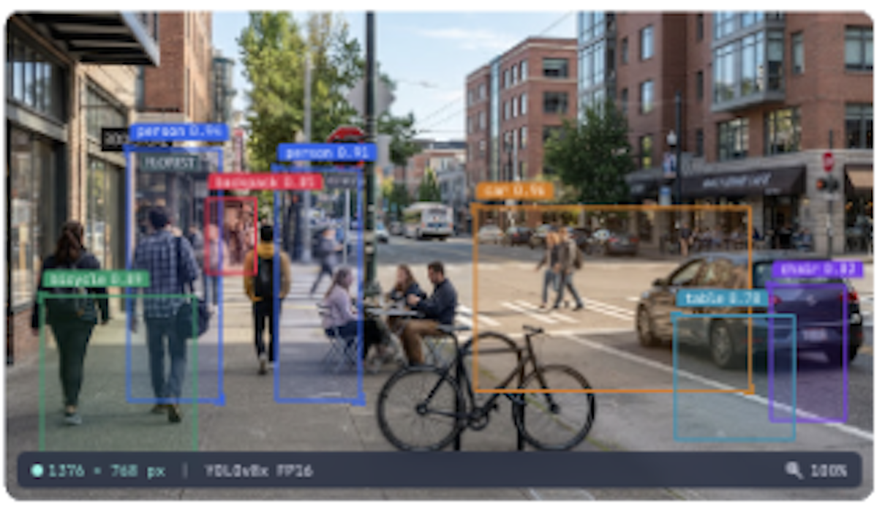
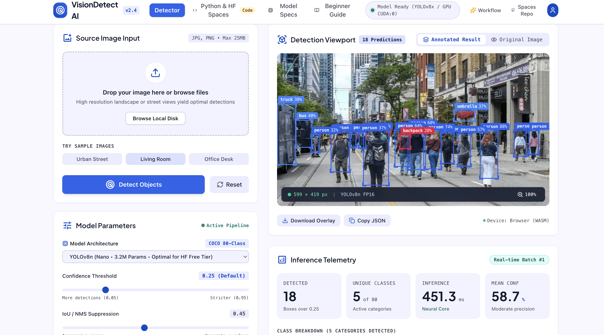

# VisionDetect AI

An AI-powered, browser-based object detection application that uses YOLOv8n and ONNX Runtime Web to identify objects in images and visualize detections with bounding boxes, class labels, and confidence scores.

## 🚀 Live Demo

## 📸 Screenshots

### Dashboard



### Object Detection Results



### Detection Example


**[Try VisionDetect AI](https://akanchibail.github.io/visiondetect-ai/)**

## ✨ Features

- **Real-time browser inference:** Run object detection directly in the browser without requiring a separate inference server.
- **YOLOv8n model:** Detect common objects using a pretrained YOLO model in ONNX format.
- **Visual detection results:** Display bounding boxes and labels around detected objects.
- **Confidence scores:** View model confidence for detected objects.
- **Multiple object classes:** Identify supported categories such as people, vehicles, and everyday objects.
- **Interactive dashboard:** Upload images and explore the detection results through a user-friendly interface.
- **Client-side processing:** Perform inference in the browser using WebAssembly through ONNX Runtime Web.

## 🛠️ Tech Stack

| Technology | Purpose |
|---|---|
| React | User interface |
| TypeScript | Application logic and type safety |
| Vite | Development server and production build |
| YOLOv8n | Object detection model |
| ONNX Runtime Web | Browser-based model inference |
| WebAssembly (WASM) | Model execution in the browser |
| GitHub Actions | Automated build and deployment |
| GitHub Pages | Static website hosting |

## ⚙️ How It Works

1. The user uploads an image through the application.
2. The image is preprocessed into the format expected by the model.
3. The YOLOv8n ONNX model performs inference in the browser.
4. The application processes the model predictions and identifies detected objects.
5. Bounding boxes, class labels, and confidence scores are displayed over the image.

## 💻 Run Locally

### Prerequisites

- Node.js and npm
- Git

### Installation

1. Clone the repository:

   ```bash
   git clone https://github.com/Akanchibail/visiondetect-ai.git
   ```

2. Navigate to the project directory:

   ```bash
   cd visiondetect-ai
   ```

3. Install dependencies:

   ```bash
   npm install --legacy-peer-deps
   ```

4. Start the development server:

   ```bash
   npm run dev
   ```

5. Open the local URL shown in your terminal.

### Production Build

To generate a production build, run:

```bash
npm run build
```

The production files will be generated in the `dist/` directory.

## 🌐 Deployment

The application is hosted on GitHub Pages. GitHub Actions automatically builds the Vite application and deploys the generated static files when changes are pushed to the `main` branch.

The object detection model runs in the browser, so the deployed frontend does not require a dedicated model inference server.

## 📂 Repository

[View the source code on GitHub](https://github.com/Akanchibail/visiondetect-ai)

## 🎯 Project Objective

This project demonstrates the integration of computer vision and web development to deliver an accessible AI application. It explores model integration, browser-based machine learning inference, image preprocessing, prediction visualization, and automated deployment.

---

**Built by Akshay Kanchibail**
